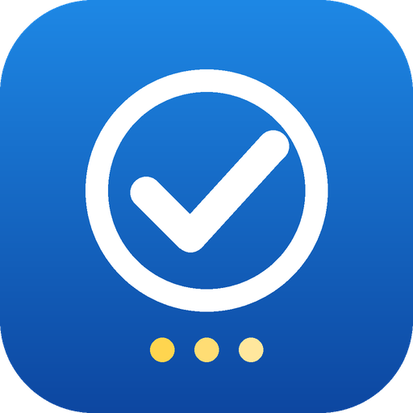

# Habit Tracker - Marketplace Listing



## App Details

- **Name**: Habit Tracker
- **Short Description**: Build better habits every day with reminders and progress reports.
- **Full Description**:

  Habit Tracker is a simple, friendly app that helps you build positive habits and stick to them. Pick the habits that matter to you, such as drinking water, working out, reading or meditating, or create your own. Each day, swipe a habit to mark it as done and watch your "To Do" list turn into a list of wins.

  Stay on track with reminders for the morning, afternoon or evening, and see how you are doing in the Reports screen, which shows today's completion rate and your recent activity. Your account, habits and settings are saved on your device, so everything is still there when you come back. Dark mode keeps it easy on the eyes at night.

  Habit Tracker is made for students, busy professionals and anyone who wants to improve their health, productivity and well-being one small step at a time.

## Keywords

Habit tracker, Habits, Daily routine, Productivity, Self-improvement, Reminders, Goals, Wellness, Streak, Motivation

## Media Assets

- **App icon**:
  - `assets/marketplace/icon_512.png` (512x512 px, Google Play Store)
  - `assets/marketplace/icon_1024.png` (1024x1024 px, Apple App Store)
- **Screenshots** (1080x1920 px):
  1. `assets/marketplace/screenshot1.png` - Login Page
  2. `assets/marketplace/screenshot2.png` - Home Page
  3. `assets/marketplace/screenshot3.png` - Reports Page
  4. `assets/marketplace/screenshot4.png` - Settings Menu
  5. `assets/marketplace/screenshot5.png` - Notifications Page
- **Promotional video**: `promo_video.mp4` (30 seconds, hosted on YouTube: [Watch the promo video](https://youtube.com/REPLACE_WITH_YOUR_VIDEO_LINK))

## Screenshots

| Login | Home | Reports | Settings Menu | Notifications |
|---|---|---|---|---|
|  |  |  |  |  |

## Promotional Video

[](https://youtube.com/REPLACE_WITH_YOUR_VIDEO_LINK)

A 30-second walkthrough: sign up, add habits, mark a habit as done, view reports and send a test notification.

---

## Features

| Feature | Where in the code |
|---|---|
| Sign up (username, email, password) with error messages | [`lib/register_screen.dart`](lib/register_screen.dart) |
| Login (email, password) with error messages | [`lib/login_screen.dart`](lib/login_screen.dart) |
| Home screen with logo, To Do / Done lists and + button | [`lib/home_screen.dart`](lib/home_screen.dart) |
| Detail screen for each habit | [`lib/detail_screen.dart`](lib/detail_screen.dart) |
| Local storage (SharedPreferences) | [`lib/storage_service.dart`](lib/storage_service.dart) |
| External API (REST Countries) | [`lib/api_service.dart`](lib/api_service.dart) |
| Settings menu (drawer) | [`lib/settings_menu.dart`](lib/settings_menu.dart) |
| Settings screen (Personal Info) | [`lib/personal_info_screen.dart`](lib/personal_info_screen.dart) |
| Configure screen (dark mode, data) | [`lib/configure_screen.dart`](lib/configure_screen.dart) |
| Reports | [`lib/reports_screen.dart`](lib/reports_screen.dart) |
| Notifications | [`lib/notifications_screen.dart`](lib/notifications_screen.dart), [`lib/notification_service.dart`](lib/notification_service.dart) |
| User stories | [`HabitTracker_user_stories.md`](HabitTracker_user_stories.md) |

## Getting Started

```bash
flutter pub get
flutter run
```

Built with Flutter using `shared_preferences`, `fluttertoast`, `http` and `flutter_local_notifications`.
